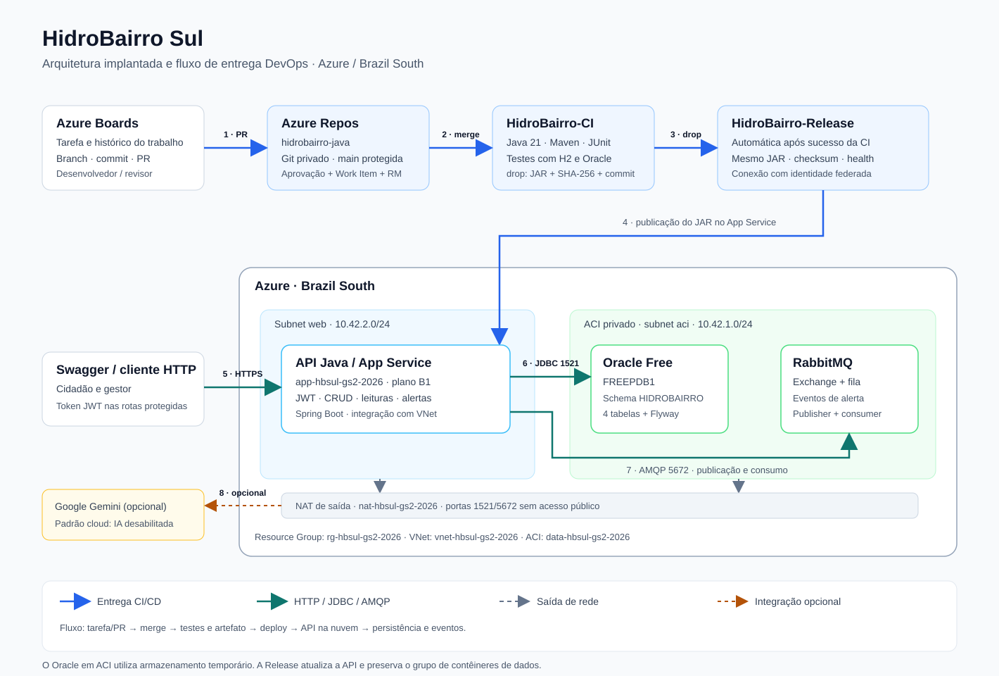

# HidroBairro Sul — DevOps Tools & Cloud Computing

**Code&Paws · Global Solution 2026/2 · FIAP · CitizenTech**

HidroBairro Sul aproxima o monitoramento de alagamentos do cidadão da Zona Sul de São Paulo, com foco em Campo Limpo, Capão Redondo e M'Boi Mirim. A API Java recebe leituras, calcula alertas e permite consultar pontos monitorados. A entrega de DevOps coloca essa API, o Oracle e o RabbitMQ no Azure, com infraestrutura por Azure CLI e integração entre Azure Boards, Repos e Pipelines.

Este repositório contém a adaptação de DevOps do [Java desenvolvido pela equipe](https://github.com/Marixavq/hidrobairro-java-gs2). O repositório Java original foi preservado. O ambiente Azure desta entrega tem configuração e banco próprios; a publicação original no Render e o código do ESP32/Wokwi não foram modificados. O projeto de Compliance permanece separado.

## Acessos da entrega

| Destino | Endereço |
|---|---|
| Swagger da API no Azure | [Abrir Swagger](https://app-hbsul-gs2-2026.azurewebsites.net/swagger-ui.html) |
| Contrato OpenAPI em JSON | [Consultar /api-docs](https://app-hbsul-gs2-2026.azurewebsites.net/api-docs) |
| Saúde da API e dependências | [Consultar /actuator/health](https://app-hbsul-gs2-2026.azurewebsites.net/actuator/health) |
| Commit informado pela Release | [Consultar /actuator/info](https://app-hbsul-gs2-2026.azurewebsites.net/actuator/info) |
| GitHub de DevOps | [TaikaWaititi/global-devops-hidrobairro](https://github.com/TaikaWaititi/global-devops-hidrobairro) |
| Organização Azure DevOps | [hidrobairro-sul-devops](https://dev.azure.com/hidrobairro-sul-devops) |
| Projeto Azure DevOps | [HidroBairro-Sul](https://dev.azure.com/hidrobairro-sul-devops/HidroBairro-Sul) |
| Código no Azure Repos | [hidrobairro-java](https://dev.azure.com/hidrobairro-sul-devops/HidroBairro-Sul/_git/hidrobairro-java) |
| Azure Boards | [Tarefas do projeto](https://dev.azure.com/hidrobairro-sul-devops/HidroBairro-Sul/_workitems) |
| Pipeline de Build | [HidroBairro-CI](https://dev.azure.com/hidrobairro-sul-devops/HidroBairro-Sul/_build?definitionId=1) |
| Pipeline de Release | [HidroBairro-Release](https://dev.azure.com/hidrobairro-sul-devops/HidroBairro-Sul/_build?definitionId=2) |

O projeto Azure DevOps é privado: Boards, Repos e Pipelines exigem acesso concedido no projeto. O Swagger é público; as operações protegidas exigem JWT. A rota `/` não oferece uma página inicial: para usar a API, abra o Swagger.

## Equipe

**Grupo:** Code&Paws. **Turma:** 2TDSA. **Professor de DevOps:** Felipe Cavalcante.

| Integrante | RM | Turma | GitHub |
|---|---|---|---|
| Arthur dos Santos Cabral | 566515 | 2TDSA | [ArthurCPV](https://github.com/ArthurCPV) |
| Bruno Martins Bettio | 564939 | 2TDSA | [TaikaWaititi](https://github.com/TaikaWaititi) |
| José Diogo Da Silva Neves | 562341 | 2TDSA | [ZeDio](https://github.com/ZeDio) |
| Júlia Tiziotto Buttler | 564975 | 2TDSA | [JuliaTButtler](https://github.com/JuliaTButtler) |
| Mariana Xavier Quispe | 566357 | 2TDSA | [Marixavq](https://github.com/Marixavq) |

**Representante e revisor padrão da main:** Bruno Martins Bettio, RM564939. O convite do professor é responsabilidade do representante, com acesso **Basic na organização** e **Project Administrators no projeto**, conforme o enunciado.

## Arquitetura macro



[Abrir o desenho em tamanho completo](docs/arquitetura-devops.svg).

1. Uma tarefa no Boards recebe os vínculos de branch, commits e pull request.
2. A conclusão da PR na `main` protegida aciona a CI. Os gatilhos automáticos não executam build nas branches de trabalho.
3. A CI compila, testa e publica resultados JUnit e o artefato `drop`.
4. O sucesso da CI aciona a Release, que baixa o pacote daquela execução, confere SHA-256 e commit e publica o JAR no App Service.
5. O cidadão ou gestor acessa a API por HTTPS, com JWT nas rotas protegidas.
6. O App Service usa integração com a VNet para acessar o Oracle pela porta 1521.
7. Alertas geram eventos publicados e consumidos pelo RabbitMQ na porta 5672, dentro da rede privada.
8. A saída das sub-redes utiliza NAT. Gemini é uma integração opcional e está desabilitado por padrão no perfil `cloud`.

### Recursos provisionados

Todos os recursos abaixo pertencem ao grupo **rg-hbsul-gs2-2026**, na região **Brazil South**.

| Recurso | Nome | Função |
|---|---|---|
| App Service Linux / Java 21 | `app-hbsul-gs2-2026` | Executa o JAR da API com HTTPS |
| App Service Plan B1 | `plan-hbsul-gs2-2026` | Capacidade de execução da aplicação |
| Azure Container Instances | `data-hbsul-gs2-2026` | Executa os contêineres `oracle` e `rabbitmq` |
| Virtual Network | `vnet-hbsul-gs2-2026` | Integra aplicação e serviços privados |
| Sub-rede do App Service | `web`, 10.42.2.0/24 | Integração da API à VNet |
| Sub-rede do ACI | `aci`, 10.42.1.0/24 | Endereço privado dos contêineres de dados |
| NAT Gateway | `nat-hbsul-gs2-2026` | Saída de rede das sub-redes |
| IP público do NAT | `pip-hbsul-gs2-2026` | Saída do NAT; não publica Oracle ou RabbitMQ |
| Identidade gerenciada | `id-hbsul-devops-deploy` | Autenticação federada da Release |

O banco usa **Oracle Database Free**, PDB **FREEPDB1** e schema **HIDROBAIRRO**. A aplicação valida o mapeamento JPA depois da migração Flyway. As tabelas de domínio são `USUARIO_HB`, `PONTO_MONITORAMENTO_HB`, `LEITURA_HB` e `ALERTA_HB`.

**Ciclo de vida dos dados:** o Oracle no ACI utiliza armazenamento temporário. A Release publica somente o JAR e não recria o ACI. Recriar ou interromper o ambiente de dados pode causar perda de dados; mantenha backup do que precisar preservar antes dessas operações. Os recursos ativos consomem cobrança/créditos da assinatura, inclusive o plano do App Service e o NAT.

## Tecnologias e responsabilidades

| Camada | Tecnologia | Aplicação no projeto |
|---|---|---|
| API | Java 21, Spring Boot 4.1.2 e Spring MVC | Endpoints REST e regras de negócio |
| Persistência | Spring Data JPA, Oracle JDBC e Flyway | Relacionamentos, transações, DDL e validação do schema |
| Segurança | Spring Security, JWT e BCrypt | Autenticação, perfis e hash de senha |
| Contratos | Bean Validation e Springdoc/OpenAPI | Validação dos DTOs e Swagger interativo |
| Mensageria | Spring AMQP e RabbitMQ | Evento de alerta após confirmação da transação |
| IA opcional | Spring AI 2.0.2 / Google GenAI | Orientação contextualizada por leituras e alertas |
| Testes | JUnit, Mockito e H2; Oracle real no CI | Regras de alerta, HTTP, permissões e persistência SQL |
| Entrega | Azure CLI, Boards, Repos e Pipelines | Provisionamento, rastreabilidade, CI e Release |

O RabbitMQ já fazia parte do Java original: `RabbitMQConfig`, `AlertaEventPublisher`, `AlertaCriadoEventListener` e `AlertaConsumer` foram preservados. Nesta entrega, o broker é executado no ACI, sem depender do PC de um integrante. A exchange é `hidrobairro.alertas.exchange`, a fila é `hidrobairro.alertas.queue` e a routing key é `alerta.criado`.

## Estrutura e scripts

| Arquivo ou diretório | Finalidade |
|---|---|
| [azure-pipeline.yml](azure-pipeline.yml) | Build, testes e artefato da CI |
| [azure-release.yml](azure-release.yml) | Gatilho de conclusão da CI e publicação no App Service |
| [scripts/provision-azure.ps1](scripts/provision-azure.ps1) | Provisionamento dos recursos Azure por CLI |
| [scripts/configure-azure-connection.ps1](scripts/configure-azure-connection.ps1) | Identidade, permissão Website Contributor e conexão federada |
| [scripts/configure-devops.ps1](scripts/configure-devops.ps1) | Bootstrap de um novo projeto privado, importação e políticas; recusa projeto já existente |
| [scripts/create-pipelines.ps1](scripts/create-pipelines.ps1) | Bootstrap das definições de CI/Release e grupo de variáveis |
| [scripts/deploy.ps1](scripts/deploy.ps1) | Publicação do JAR com tentativas limitadas e health check |
| [scripts/test-oracle-ci.sh](scripts/test-oracle-ci.sh) | Oracle temporário e testes de integração, com limpeza ao terminar |
| [scripts/script-bd.sql](scripts/script-bd.sql) | DDL dos objetos de domínio Oracle |
| [scripts/verificar-crud.sql](scripts/verificar-crud.sql) | CRUD SQL nas quatro tabelas, com registros próprios e rollback |
| [dockerfiles/Dockerfile](dockerfiles/Dockerfile) | Build/testes e imagem Java para uso em contêiner |
| [docs/arquitetura-devops.svg](docs/arquitetura-devops.svg) | Desenho macro com fluxo e legenda |
| [src/main/java/com/fiap/gs_hidrobairro](src/main/java/com/fiap/gs_hidrobairro) | Código Java em controller, service, repository, model e componentes de infraestrutura |
| [src/main/resources/db/migration](src/main/resources/db/migration) | Migração aplicada pelo Flyway antes da validação JPA |
| [src/test](src/test) | Testes e configuração isolada dos serviços externos |

O App Service recebe o **JAR**; o Dockerfile Java é uma alternativa de empacotamento. As imagens dos contêineres de dados são `gvenzl/oracle-free:23-slim` e `rabbitmq:4.1-alpine`. Não há VM própria nem ACR nesta arquitetura implantada.

## Executar os testes

Requisitos: Git e **JDK 21**. O Maven Wrapper já acompanha o repositório; não é necessário instalar Maven separadamente.

```powershell
git clone https://github.com/TaikaWaititi/global-devops-hidrobairro.git
Set-Location global-devops-hidrobairro
.\mvnw.cmd --batch-mode --no-transfer-progress clean verify
```

No Linux ou Git Bash:

```bash
chmod +x mvnw
./mvnw --batch-mode --no-transfer-progress clean verify
```

Essa execução usa H2 em modo Oracle e configurações de teste: listeners RabbitMQ desabilitados e publisher simulado. Não exige banco FIAP, broker local ou chave Gemini real. Os relatórios ficam em `target/surefire-reports`.

Para repetir o teste com Oracle real, use Bash, Docker Engine em execução, OpenSSL e JDK 21, com a porta local 1525 livre:

```bash
bash scripts/test-oracle-ci.sh
```

O script cria um Oracle temporário, gera credenciais aleatórias, aguarda disponibilidade, aplica Flyway, valida o schema e executa os testes. Ao terminar, remove somente o contêiner criado por essa execução. Esse banco é separado do Oracle da aplicação no Azure.

As suítes executam **32 testes por ambiente**: 5 regras de alerta, 13 testes de API e 14 testes da API no perfil sem IA. O perfil sem IA reaplica os testes de API e acrescenta a resposta 503 da orientação. Com H2 e Oracle real, a CI publica **64 resultados**. Os testes incluem CRUD com comprovação SQL, e-mail duplicado, proteção de perfis, JWT inválido, conta desativada e bloqueio da exclusão de ponto com histórico.

## Executar a API localmente

Para desenvolvimento local, use **PowerShell 7, JDK 21 e Docker**. As portas 8080, 1526 e 5673 e os nomes de contêineres deste exemplo devem estar livres. Os comandos criam serviços locais separados do Azure e geram senhas apenas na memória da sessão.

Na raiz do repositório:

```powershell
$ErrorActionPreference = 'Stop'
$env:ORACLE_PASSWORD = 'Hb' + [guid]::NewGuid().ToString('N')
$env:APP_USER = 'hidrobairro'
$env:APP_USER_PASSWORD = 'Hb' + [guid]::NewGuid().ToString('N')

docker run -d --name hidrobairro-oracle-local -p 127.0.0.1:1526:1521 `
  --env ORACLE_PASSWORD --env APP_USER --env APP_USER_PASSWORD `
  --health-cmd healthcheck.sh --health-interval 5s --health-timeout 5s --health-retries 90 `
  gvenzl/oracle-free:23-slim
if ($LASTEXITCODE -ne 0) { throw 'Falha ao iniciar Oracle local.' }

$limit = (Get-Date).AddMinutes(8)
do {
  $state = docker inspect --format '{{.State.Health.Status}}' hidrobairro-oracle-local
  if ($state -eq 'healthy') { break }
  if ((Get-Date) -gt $limit) { throw 'Oracle local nao ficou saudavel no limite previsto.' }
  Start-Sleep -Seconds 5
} while ($true)

$env:RABBITMQ_DEFAULT_USER = 'hidrobairro'
$env:RABBITMQ_DEFAULT_PASS = 'Hb' + [guid]::NewGuid().ToString('N')
docker run -d --name hidrobairro-rabbit-local -p 127.0.0.1:5673:5672 `
  --env RABBITMQ_DEFAULT_USER --env RABBITMQ_DEFAULT_PASS rabbitmq:4.1-alpine
if ($LASTEXITCODE -ne 0) { throw 'Falha ao iniciar RabbitMQ local.' }

$env:ORACLE_URL = 'jdbc:oracle:thin:@//localhost:1526/FREEPDB1'
$env:ORACLE_USER = $env:APP_USER
$env:ORACLE_PASSWORD = $env:APP_USER_PASSWORD
$env:RABBITMQ_HOST = 'localhost'
$env:RABBITMQ_PORT = '5673'
$env:RABBITMQ_USER = $env:RABBITMQ_DEFAULT_USER
$env:RABBITMQ_PASSWORD = $env:RABBITMQ_DEFAULT_PASS
$env:JWT_SECRET = [Convert]::ToBase64String([Security.Cryptography.RandomNumberGenerator]::GetBytes(32))
$env:SPRING_PROFILES_ACTIVE = 'cloud'
$env:AI_CHAT_MODEL = 'none'
$env:HIDROBAIRRO_BOOTSTRAP_ENABLED = 'true'
$env:BOOTSTRAP_GESTOR_EMAIL = 'gestor@hidrobairro.example'
$managerSecret = Read-Host 'Defina a senha do gestor local, com pelo menos 12 caracteres' -AsSecureString
$env:BOOTSTRAP_GESTOR_PASSWORD = [Net.NetworkCredential]::new('', $managerSecret).Password

.\mvnw.cmd spring-boot:run
```

Abra [o Swagger local](http://localhost:8080/swagger-ui.html). O schema novo deve começar vazio: a aplicação aplica a migração Flyway e depois valida as entidades. Não execute o DDL manualmente antes dessa primeira migração. Para encerrar a API, pressione **Ctrl+C**; os contêineres locais têm ciclo de vida próprio.

O arquivo [.env.example](.env.example) relaciona as variáveis, mas **não é carregado automaticamente pelo Spring Boot**. Use variáveis da sessão, da IDE ou do ambiente de execução. A aplicação usa a arquitetura `Controller → Service → Repository → Oracle`.

## Configuração de ambiente e segurança

| Variável | Uso |
|---|---|
| `ORACLE_URL`, `ORACLE_USER`, `ORACLE_PASSWORD` | Conexão JDBC da API; no Azure, endereço privado e serviço FREEPDB1 |
| `ORACLE_ADMIN_PASSWORD` | Somente provisionamento do Oracle em nuvem; não é a senha do usuário da API |
| `RABBITMQ_HOST`, `RABBITMQ_PORT`, `RABBITMQ_USER`, `RABBITMQ_PASSWORD` | Conexão AMQP; porta padrão 5672 |
| `JWT_SECRET` | Chave aleatória em Base64 representando pelo menos 32 bytes |
| `SPRING_PROFILES_ACTIVE` | `cloud` no ambiente de DevOps |
| `AI_CHAT_MODEL` | `none` por padrão em cloud; `google-genai` habilita o provedor original |
| `GEMINI_API_KEY`, `GEMINI_MODEL` | Necessários para usar a orientação por IA com o provedor original |
| `HIDROBAIRRO_BOOTSTRAP_ENABLED` | Habilita a criação inicial do gestor quando `true` |
| `BOOTSTRAP_GESTOR_EMAIL`, `BOOTSTRAP_GESTOR_PASSWORD` | Conta inicial do gestor; senha mínima de 12 caracteres |
| `APP_VERSION` | Commit informado pela Release e exibido em `/actuator/info` e no Swagger |

No perfil `cloud`, a API funciona com autenticação, CRUD, leituras, alertas e RabbitMQ sem chave de IA. A rota de orientação responde **503** enquanto o provedor estiver desabilitado. Para habilitar Gemini, configure `AI_CHAT_MODEL=google-genai`, chave válida e modelo disponível para essa chave. A configuração do modelo deve corresponder ao provedor contratado; o projeto não simula uma resposta de IA quando ele está indisponível.

O bootstrap cria o gestor somente quando a conta não existe. Se a conta já existe como gestor, preserva a senha e os dados; se existe como cidadão, recusa promoção automática. Alterar a variável de bootstrap não redefine a senha de uma conta já cadastrada.

Senhas e chaves não são publicadas no GitHub, README, vídeo ou artefato. O provisionamento usa `secureValue` no ACI e App Settings no App Service. A Release usa **Workload Identity Federation**, sem senha permanente de service principal, com **Website Contributor somente no grupo de recursos da entrega**. A conexão é autorizada para a Release.

## Provisionamento e CI/CD

Os recursos atuais já estão provisionados. **Não execute bootstrap ou provisionamento para gravar cada demonstração.** Os scripts servem à reprodução e manutenção por um operador autorizado, com as credenciais corretas guardadas em local seguro. O provisionamento não faz backup/restauração nem troca a senha de um Oracle já existente.

O script `provision-azure.ps1` exige na sessão `ORACLE_PASSWORD`, `ORACLE_ADMIN_PASSWORD`, `RABBITMQ_PASSWORD` e `JWT_SECRET`; as regras de formato são validadas antes da criação de recursos. As credenciais de bootstrap e Gemini são opcionais. O comando utilizado para esta infraestrutura é:

```powershell
.\scripts\provision-azure.ps1 `
  -SubscriptionId ee9f1b11-9176-4a17-bccc-67ff9d94ad32 `
  -Prefix hbsul-gs2-2026 `
  -Location brazilsouth
```

O script preserva o ACI existente e recusa utilizar um grupo existente sem a tag de projeto esperada. Para nova execução sobre este ambiente, reutilize as credenciais originais; fornecer outras senhas pode impedir a conexão da API com o banco existente.

A configuração da conexão de serviço está reproduzida em:

```powershell
.\scripts\configure-azure-connection.ps1 `
  -Organization https://dev.azure.com/hidrobairro-sul-devops `
  -Project HidroBairro-Sul `
  -ResourceGroup rg-hbsul-gs2-2026
```

### Fluxo de trabalho e proteção da main

- O trabalho parte de uma tarefa do Boards, com branch e commits associados; `AB#` seguido do ID permite mencionar a tarefa no commit.
- A PR aponta para `main` e deve ter Work Item vinculado e aprovação.
- O revisor obrigatório padrão é **RM564939**. O autor pode aprovar a própria PR na simulação acadêmica.
- As políticas são obrigatórias e os votos são reiniciados após novos pushes.
- Os gatilhos estão no Azure Repos. Atualizar somente a cópia do GitHub não dispara esta CI; o fluxo de entrega entra por PR no Azure Repos. O GitHub é mantido sincronizado.

### Build — HidroBairro-CI

O [YAML da CI](azure-pipeline.yml), na raiz, usa agente Microsoft hospedado **Ubuntu 24.04**, seleciona JDK 21 e tem gatilho na `main`, com agrupamento de commits por `batch`. Não há build de validação antes do merge neste fluxo.

| Etapa | Resultado |
|---|---|
| Checkout e seleção do JDK | Código da revisão da execução e Java 21 |
| Maven `clean verify` | Compilação e testes com H2 |
| `test-oracle-ci.sh` | Migração, validação de schema e testes com Oracle real isolado |
| `PublishTestResults@2` | Resultados JUnit na aba Tests; falha em teste reprovado ou relatório ausente |
| Preparação do pacote | `app.jar`, `app.jar.sha256` e `commit.txt` |
| `PublishPipelineArtifact@1` | Artefato `drop` no Azure Pipelines |

### Release — HidroBairro-Release

O [YAML da Release](azure-release.yml) usa a conclusão bem-sucedida da `HidroBairro-CI` em `main` como gatilho. A etapa de deploy exige `ResourceTrigger`; uma execução manual não publica o JAR.

1. Baixa o `drop` da CI de origem; não recompila o Java.
2. Confere o SHA-256 do JAR e o commit registrado no pacote.
3. Autentica no Azure pela conexão `sc-hidrobairro-azure`.
4. Informa `APP_VERSION` e publica o JAR no App Service com Azure CLI.
5. Em falha de publicação, tenta novamente o mesmo pacote até quatro vezes, com espera progressiva.
6. Aguarda `/actuator/health` retornar `UP`; falha se a API não ficar saudável no limite previsto.

O grupo de variáveis **hidrobairro-deploy** contém somente os identificadores `azureServiceConnection=sc-hidrobairro-azure`, `resourceGroup=rg-hbsul-gs2-2026` e `webAppName=app-hbsul-gs2-2026`. Senhas de banco, RabbitMQ e JWT permanecem na configuração da aplicação/infraestrutura. O script de Release não provisiona nem recria o Oracle ou o RabbitMQ.

## Autenticação e endpoints

O gestor de demonstração é **gestor@hidrobairro.example**. O mantenedor autorizado obtém a senha pelo canal seguro da equipe ou pela configuração `BOOTSTRAP_GESTOR_PASSWORD` do App Service, quando ela ainda corresponde à conta criada. A senha não é documentada publicamente.

No Swagger, faça login em `POST /api/auth/login` com os campos `email` e `senha`. A resposta **200** contém `token`. Em **Authorize**, cole somente seu valor, sem aspas e sem acrescentar `Bearer`; o Swagger monta o cabeçalho. O JWT tem validade de 24 horas. Um **401** em Server response é falha real; a seção Responses abaixo também lista respostas possíveis do contrato, mesmo após uma chamada bem-sucedida.

| Método e rota | Finalidade | Acesso |
|---|---|---|
| `POST /api/auth/login` | Autenticar e obter JWT | Público |
| `POST /api/usuarios` | Cadastrar cidadão | Público; somente papel CIDADAO |
| `GET /api/usuarios` e `GET /api/usuarios/email/{email}` | Listar/buscar usuários | GESTOR |
| `GET /api/usuarios/{id}` e `PUT /api/usuarios/{id}` | Consultar/alterar a própria conta | CIDADAO ou GESTOR, proprietário da conta |
| `DELETE /api/usuarios/{id}` | Excluir usuário | GESTOR; exceto a própria conta |
| `PATCH /api/usuarios/{id}/desativar` ou `/reativar` | Alterar atividade da conta | GESTOR; desativação própria bloqueada |
| `GET /api/pontos-monitoramento` e `GET /api/pontos-monitoramento/{id}` | Consultar pontos | CIDADAO ou GESTOR |
| `POST`, `PUT /{id}` e `DELETE /{id}` em `/api/pontos-monitoramento` | Gerenciar pontos | GESTOR |
| `PATCH /api/pontos-monitoramento/{id}/desativar` ou `/reativar` | Alterar atividade do ponto | GESTOR |
| `POST /api/leituras` | Registrar nível e avaliar alertas | Autenticado |
| `GET /api/leituras` e `GET /api/leituras/{id}` | Consultar leituras | CIDADAO ou GESTOR |
| `POST /api/iot/leituras?pontoId=` | Receber distância do sensor | Público; informar ID real de ponto ativo |
| `GET /api/alertas`, `/api/alertas/{id}` e `/api/alertas/ativos` | Consultar alertas | CIDADAO ou GESTOR |
| `POST /api/ia/orientacoes` | Solicitar orientação contextualizada | Autenticado; 503 com IA desabilitada |

Os IDs são gerados pelo banco. Use sempre o ID recebido na criação; os valores do ambiente Render não identificam os registros do banco Azure. Listagens de usuários, pontos, leituras e alertas usam paginação Spring Data.

### CRUD de pontos no Swagger

Com o token de gestor, crie um registro de teste em `POST /api/pontos-monitoramento`:

```json
{
  "nome": "Ponto teste CRUD",
  "subprefeitura": "Campo Limpo",
  "bairro": "Campo Limpo",
  "zona": "SUL",
  "latitude": -23.6485,
  "longitude": -46.7652,
  "limiarAlertaCm": 50
}
```

| Operação | Procedimento | Resposta real esperada |
|---|---|---|
| Create | Enviar o POST e anotar o ID retornado | 201 |
| Read | Consultar o GET por esse ID | 200 |
| Update | Enviar o JSON completo no PUT por ID, mudando `nome` para `Ponto atualizado CRUD` | 200 |
| Delete | Executar DELETE por ID no ponto criado para o teste | 204, sem corpo |

Use um ponto sem leituras/alertas para o DELETE. As chaves estrangeiras preservam o histórico: excluir ponto com registros relacionados retorna **409**; a alternativa de negócio é desativá-lo. O Swagger pode apresentar 200 na documentação automática do DELETE, mas o retorno implementado e testado é 204.

### CRUD de usuários no Swagger

O cadastro público cria somente cidadãos. Para evitar uma senha fixa de exemplo no README, prepare o JSON no PowerShell 7 e cole o conteúdo da área de transferência no corpo de `POST /api/usuarios`:

```powershell
$secret = Read-Host 'Defina a senha temporaria do cidadao de teste, com pelo menos 6 caracteres' -AsSecureString
$cadastro = @{
  nome = 'Usuario teste CRUD'
  email = 'crud.' + [guid]::NewGuid().ToString('N') + '@example.test'
  senha = [Net.NetworkCredential]::new('', $secret).Password
  papel = 'CIDADAO'
}
$cadastro | ConvertTo-Json | Set-Clipboard
```

1. Execute o POST, espere **201** e anote ID, e-mail e senha do usuário de teste.
2. Faça login como esse cidadão e substitua o token em Authorize.
3. Consulte o GET por ID da própria conta: **200**.
4. No PUT da própria conta, envie todos os campos do cadastro e altere o nome: **200**.
5. Restaure o token do gestor e exclua o cidadão de teste: **204**.

Consultar ou alterar por ID a conta de outra pessoa é bloqueado, inclusive para o gestor nessa rota. Use o GET por e-mail ou a listagem de gestor para consultas administrativas. E-mail duplicado retorna **409**; JSON ou campos inválidos retornam **400**; token inválido retorna **401**; falta de permissão retorna **403**. Não exponha a área de transferência, senhas ou tokens durante a gravação.

## Comprovação SQL no Oracle da nuvem

Depois de **cada** operação HTTP do CRUD, mostre a persistência com SELECT no banco Azure. O GET demonstra a API, mas não substitui essa consulta direta na avaliação. O procedimento abaixo exige autenticação Azure e permissão de execução no ACI.

No terminal autenticado com Azure CLI:

```powershell
az container exec --resource-group rg-hbsul-gs2-2026 `
  --name data-hbsul-gs2-2026 --container-name oracle --exec-command /bin/bash
```

Dentro do contêiner, abra o SQLPlus:

```bash
sqlplus / as sysdba
```

Selecione o PDB e o schema:

```sql
ALTER SESSION SET CONTAINER=FREEPDB1;
ALTER SESSION SET CURRENT_SCHEMA=HIDROBAIRRO;

SELECT id, nome, email, papel, ativo
FROM usuario_hb WHERE id = &id_usuario;

SELECT id, nome, limiar_alerta_cm, ativo
FROM ponto_monitoramento_hb WHERE id = &id_ponto;
```

O SQLPlus pede o ID na execução da consulta. Após o UPDATE, confira o campo alterado. Depois de cada DELETE:

```sql
SELECT COUNT(*) AS restantes FROM usuario_hb WHERE id = &id_usuario;
SELECT COUNT(*) AS restantes FROM ponto_monitoramento_hb WHERE id = &id_ponto;
```

O resultado para o registro excluído deve ser **0**. Esse acesso administrativo fica restrito ao operador Azure autorizado; a API conecta com o usuário de aplicação, e a porta Oracle não está publicada na Internet.

O arquivo [verificar-crud.sql](scripts/verificar-crud.sql) complementa a demonstração nas **quatro tabelas**: cria registros próprios com IDs gerados, executa SELECTs, UPDATEs e DELETEs na ordem das FKs e termina com rollback. Execute seu conteúdo em uma sessão dedicada de SQLPlus, sem misturar transações de outros trabalhos. As operações SQL de demonstração não publicam eventos Java; o fluxo de mensageria deve ser exercitado pelo endpoint de leitura.

### Leituras, alertas e mensageria

Uma leitura abaixo do limiar encerra um alerta ativo; no limiar gera ATENCAO; a partir de 1,5 vez o limiar gera CRITICO. Ao criar um alerta novo, o Java publica o evento após o commit e o consumer RabbitMQ o processa. Atualizações de alerta existente não publicam o mesmo evento de criação novamente.

O contrato IoT recebe `distanciaCm`, `data`, `horario` e `leituraValida`, além do `pontoId` na query. O ID deve ser de um ponto ativo do Azure. A API usa a referência de simulação de **400 cm** e calcula `nivelCm = 400 - distanciaCm`; por exemplo, distância 325 resulta em nível 75. Essa referência precisa de calibração numa instalação física. O horário persistido da leitura é gerado pelo servidor. A implementação do ESP32 não é distribuída por este repositório de DevOps.

## Evidências e apresentação

Execuções de referência concluídas com sucesso:

- [CI 7: build, 64 resultados de teste e artefato drop](https://dev.azure.com/hidrobairro-sul-devops/HidroBairro-Sul/_build/results?buildId=7).
- [Release 8: disparo automático por conclusão da CI e API saudável](https://dev.azure.com/hidrobairro-sul-devops/HidroBairro-Sul/_build/results?buildId=8).
- [Tarefa inicial 1, com vínculos de desenvolvimento](https://dev.azure.com/hidrobairro-sul-devops/HidroBairro-Sul/_workitems/edit/1).
- [Tarefa 2, provisionamento e validação da entrega](https://dev.azure.com/hidrobairro-sul-devops/HidroBairro-Sul/_workitems/edit/2).

Também foram validados CRUD HTTP de usuários e pontos com SELECT após cada operação, CRUD SQL nas quatro tabelas e uma leitura sintética que gerou alerta, com mensagem publicada, roteada, entregue e confirmada pelo consumidor RabbitMQ.

Na gravação, apresente este README e o desenho, mostre no Portal Azure os recursos criados pelos scripts, crie uma nova tarefa e branch, faça uma alteração real no Java, vincule commit e PR, conclua o merge e mostre CI, testes, artefato, Release e alteração publicada. Demonstre o CRUD com SELECT no Oracle em nuvem e conclua a tarefa com os vínculos visíveis. A infraestrutura existente pode ser reutilizada; não recrie o banco para gravar o vídeo.

O capítulo de DevOps pede vídeo narrado, áudio claro e resolução mínima de 720p; a comprovação CRUD deve ser contínua e sem cortes. A entrega no Portal é um PDF com identificação completa do grupo e links da organização e do vídeo no YouTube. Os requisitos estão nas páginas **37–53** do enunciado Global Solution 2026/2, com roteiro nas páginas **43–44** e formato de entrega na página **50**. A publicação do vídeo, o envio do PDF e o acesso do professor devem ser concluídos pela equipe.

## Declaração de uso de IA

Esta adaptação de DevOps contou com apoio do **OpenAI Codex** para leitura dos requisitos, revisão e ajustes de configuração/código, criação de testes e scripts, execução de validações, configuração de CI/CD, redação deste README e elaboração do diagrama. A base Java pertence ao projeto da equipe referenciado no início. Os integrantes são responsáveis por revisar, compreender e defender tecnicamente a entrega e suas escolhas.
